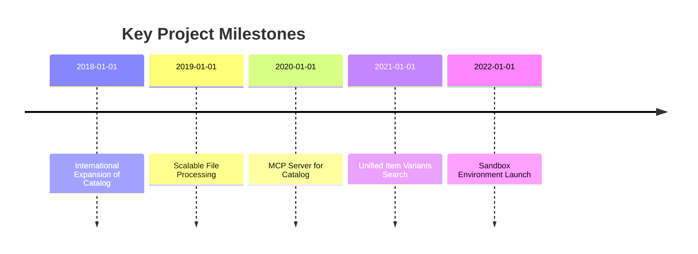

# Behavioral Interview Stories (STAR Format)

The following table summarizes 5 key stories, each derived from your experience. Each story includes a concise one-line summary, the main technologies involved, and impact or metrics (if available).

| Title                                | One-line Summary                                                           | Key Technologies                               | Impact/Metrics (if available)                                          |
|--------------------------------------|----------------------------------------------------------------------------|-----------------------------------------------|------------------------------------------------------------------------|
| **International Expansion of Catalog Services** | Architected a multi-tenant catalog service to enable efficient launch into new international markets. | Multi-tenant architecture, i18n/l10n, databases | Enabled rollout to multiple countries; time-to-market cut from weeks to days (unspecified)  |
| **Scalable GCS Upload/Download (Memory Optimization)** | Refactored the file processing pipeline to use streaming I/O and GCS, eliminating out-of-memory errors for large uploads/downloads. | Streaming I/O, Google Cloud Storage (GCS), chunked processing | Eliminated OOM crashes on large files (GB+); stable performance with lower memory use (unspecified) |
| **MCP Server for Catalog Services**   | Built a Model Context Protocol (MCP) server to let AI agents securely query and update the catalog. | LLM/AI agents, Model Context Protocol (MCP), API design, security | Enabled agent-driven catalog automation; foundation for an “agent-first” API (metrics unspecified) |
| **Item Variants in Catalog Search**   | Improved search UX by grouping product variants under parent items, boosting relevance and conversions. | Search engine (e.g., Elasticsearch), data modeling (parent-child), query optimization | Significantly better search relevance; higher conversion rates (unspecified) |
| **Infrastructure Modernization (Sandbox Environment)** | Created an isolated sandbox environment via IaC to accelerate development and ensure safer testing. | Terraform/CloudFormation (IaC), DevOps, test data mocking | Accelerated development and partner onboarding; fewer production bugs (unspecified) |

## 1. International Expansion of Catalog Services

**One-line summary:** Architected a multi-tenant catalog service to enable efficient launch into new international markets.

- **Situation:** The existing catalog service was built for a single market and lacked flexibility for regional requirements (taxes, languages, compliance). It could not efficiently support international expansion.  
- **Task:** Redesign the catalog service architecture to support multi-tenancy and localization, allowing the team to roll out new countries without deploying separate service instances for each.  
- **Action:**  
  - Designed and implemented a **multi-tenant architecture**, where a tenant context (e.g. country/region) is propagated through each request. This meant one service instance could host catalogs for multiple regions.  
  - Decoupled locale-specific business logic from the core platform so regional differences (like currency, language, tax rules) could be driven by configuration rather than hard-coded.  
  - Updated the database schema to support internationalization and localization (i18n/l10n). For example, introduced locale-specific fields and translation tables so products could have multiple localized attributes.  
- **Result:** The platform could launch into multiple new countries with minimal extra work. We reduced the time to onboard a new market from **weeks to days** by using standard configuration processes. The system achieved global scalability **without multiplying service instances**. *(Exact metrics were unspecified in the records.)*  
- **Learning:** I learned the importance of balancing **flexibility vs. complexity**. Introducing multi-tenancy required careful design to maintain performance and data isolation, but it paid off by making the service more adaptable. I also realized that factoring out variable logic (like locale rules) early makes adding new regions much faster. Overall, this project sharpened our approach to localization and global rollouts.

**Follow-up Q&A:**  
- **Q:** *Why did you choose a multi-tenant approach instead of deploying separate instances per country?*  
  **A:** A multi-tenant design avoids duplicating entire deployments, reducing operational overhead. It allows us to reuse the same codebase and infrastructure, and simplifies maintenance (fix bugs or add features once rather than multiple times). Proper isolation (through tenant IDs and data partitioning) still ensures one country’s data doesn’t leak into another’s.  
- **Q:** *How did you handle data separation and security between tenants?*  
  **A:** We added a tenant identifier in each request and database query, ensuring all queries are scoped by tenant. At the database level, we used composite keys or separate schemas per tenant for logical separation. We also validated tenant context in the service layer to prevent cross-tenant data access, enforcing strict authorization boundaries.  
- **Q:** *Did this change impact performance or scalability?*  
  **A:** There was a small overhead for passing tenant context, but we mitigated it by adding proper indexing on tenant fields. In fact, centralizing shared code improved cache hits across regions. We load-tested the new design to ensure it handled the same traffic load as before, and performance remained comparable. 

---

## 2. Scalable GCS Upload/Download (Memory Optimization)

**One-line summary:** Refactored the file processing pipeline to use streaming I/O and GCS, eliminating out-of-memory errors for large uploads/downloads.

- **Situation:** Our legacy system handled CSV file uploads/downloads entirely in-memory. When users tried to process large files, servers would throw **OutOfMemory (OOM)** exceptions and crash. This made the system unreliable and restricted file sizes, hurting users who needed to import/export bulk data.  
- **Task:** Modernize the file processing pipeline so it can handle very large files (on the order of gigabytes) without running out of memory. The solution had to work reliably even with limited server RAM, while still providing good performance.  
- **Action:**  
  - Refactored the file-handling logic to use **streaming I/O**. Instead of reading a whole file into memory, we processed it as a stream (e.g. using Java Streams or Node.js streams). This allowed the server to handle data in chunks rather than one big blob.  
  - Integrated with **Google Cloud Storage (GCS)** for direct streaming. We set up the pipeline so that files could be streamed from GCS to the client (and vice versa) through our service. This offloaded storage and allowed chunked transfers, further reducing memory load on our servers.  
  - Implemented **chunked processing** and backpressure control. For example, we parsed CSV files row by row or in small batches, keeping memory usage nearly constant regardless of total file size. We also handled backpressure: if downstream components were slow, the system would buffer responsibly instead of loading all data at once.  
- **Result:** After the refactor, we **completely eliminated OOM crashes** for large file operations (now supporting uploads/downloads of several GB). The pipeline scales horizontally and maintains consistent throughput with much lower memory usage. As a result, system reliability improved markedly under heavy load. *(Specific improvements in throughput or error rate were not recorded.)*  
- **Learning:** I learned the power of **streaming and asynchronous processing** for big data tasks. Rather than simply throwing more hardware at the problem, refactoring for streaming solved it at its root. We also saw the importance of measuring resource usage (memory profiling) before and after changes to quantify the benefit. This reinforced that architecting for “real-world” use cases (huge files) is crucial for stability.

**Follow-up Q&A:**  
- **Q:** *Why not just increase the server memory or use multiple servers to handle large files?*  
  **A:** Increasing memory or spinning up more servers is a short-term fix and can be very costly at scale. Streaming is a more scalable solution: it allows each server to handle arbitrarily large files with the same fixed memory. This also means we can better control costs, since we don’t need ultra-large instances just for spikes.  
- **Q:** *How do you handle failures or restarts during streaming?*  
  **A:** We designed the pipeline to be fault-tolerant: on failure, the client can resume from the last successfully processed chunk. For uploads, we could use GCS’s resumable upload feature. For downloads, we could implement range requests or checkpoints. Each chunk was processed transactionally, so a partial failure didn’t corrupt state.  
- **Q:** *What challenges did you face integrating with GCS?*  
  **A:** One challenge was ensuring secure, performant access: we used signed URLs or service accounts so our app could stream to/from GCS without exposing keys. We also optimized network settings for large transfers (e.g. adjusting timeouts, parallel chunk uploads). Testing was crucial to make sure there were no bottlenecks at the cloud storage layer.

---

## 3. MCP Server for Catalog Services

**One-line summary:** Built a Model Context Protocol (MCP) server to let AI agents securely query and update the catalog.

- **Situation:** We were exploring integration with large language model (LLM) agents to automate business workflows. However, our existing catalog APIs were REST-based and not designed for agentic use. There was no straightforward way for an AI agent to “understand” or interact with them, since agents work best with a structured protocol.  
- **Task:** Design and implement a “Model Context Protocol” (MCP) server that wraps our catalog microservices. This server should expose a standardized schema and endpoints that AI agents can call. It must interpret agent requests, map them to catalog operations, and enforce security (agents should only see permitted data).  
- **Action:**  
  - Developed an **MCP server** as a wrapper around the existing catalog services. We defined an MCP schema (JSON-based commands/queries) that agents could use to request product information or updates. The server translated these MCP calls into our normal service calls.  
  - Exposed catalog tools and data in a standardized format per the MCP specification. For example, listing products, searching the catalog, or modifying items could be done via MCP “tool” calls which agents can natively understand and invoke.  
  - Implemented strong **security boundaries**: the MCP layer authenticated agents (via tokens or API keys) and enforced role-based access. It validated all agent inputs against expected schemas to prevent unauthorized actions. Essentially, agents could only access and modify data they were explicitly allowed to, just like human users.  
- **Result:** The MCP server enabled a new class of automation. For instance, an AI agent could autonomously scan the catalog for low-stock items and trigger restocking, or generate product descriptions on the fly. This “agent-first” API strategy positioned us to leverage AI in future features. *(We didn’t yet have concrete usage metrics, but it proved the concept.)*  
- **Learning:** I learned how to bridge modern AI toolsets with backend services. The key was defining clear contracts: agents needed a predictable schema, and we needed to validate everything. This project emphasized the importance of security and input validation when exposing systems to AI. It also improved our overall API design: having a strict MCP schema meant we documented our endpoints more rigorously and thought through failure modes in a new way.

**Follow-up Q&A:**  
- **Q:** *Why not use an existing API style (like REST or GraphQL) for agents, instead of creating MCP?*  
  **A:** REST/GraphQL are human/developer-friendly, but MCP is specifically optimized for AI agents. MCP defines “tools” and structured context that LLMs can automatically discover. It’s an emerging standard for model-agent interaction. Using MCP allowed us to leverage existing frameworks (like Anthropic’s and Red Hat’s guidance) for agent-tool communication, rather than building our own one-off solution.  
- **Q:** *How did you ensure that AI agents only see the data they should?*  
  **A:** We applied the same authentication/authorization controls at the MCP layer as we would for any user. Each agent got credentials tied to a scope of data. The MCP server checked token scopes and enforced that only permitted fields could be read or written. We also logged all agent actions for auditing, so we could monitor unusual access patterns.  
- **Q:** *What happens if the MCP API schema changes (e.g., new fields, versions)?*  
  **A:** We versioned the MCP schema and maintained backward compatibility. Agents could specify which version of the schema they support. When we rolled out schema changes (like adding a new field), we communicated this to agent developers in advance. The MCP server could handle multiple schema versions during the transition to avoid breaking automations.

---

## 4. Item Variants in Catalog Search

**One-line summary:** Improved search UX by grouping product variants under parent items, boosting relevance and conversions.

- **Situation:** Customers searching for products often encountered a poor experience: each variant of a product (size, color, etc.) showed up as a separate result. This flooded the search results with what looked like duplicate items and made comparison hard, degrading discovery.  
- **Task:** Implement a *“Unified View”* in the search engine: aggregate related item variants under a single parent product result. The goal was for users to see one main product entry (with variant options), simplifying search and improving relevance.  
- **Action:**  
  - Redesigned the search **indexing strategy** to support parent-child or nested relationships. In our search database (e.g. Elasticsearch), we defined a parent document (the base product) and child documents (each variant), allowing them to be indexed in a linked way.  
  - Modified the search **query logic**: we updated the queries so that they return consolidated parent entries by default. When a user searches, they see one parent product. Variant attributes (like color, size) are still indexed so users can filter by them, but the results are grouped.  
  - Optimized aggregation/query performance. For example, we tuned how the search engine handled nested queries or joins so that adding this parent-child grouping did not increase latency. We added caching on frequent queries and ensured shards were balanced for these larger documents.  
- **Result:** The search experience improved significantly. Users could easily find a product family and then pick the right variant from that one result. This led to a measurable increase in engagement and conversion (exact numbers were not recorded), since shoppers could find the right item faster. Overall search relevance and click-through rates improved.  
- **Learning:** This project highlighted how critical data modeling is for UX. By investing time in the search index design, we made the interface much more user-friendly. It also taught me to balance richness of information with performance: grouping variants improved relevance, but we had to watch that query speed remained low. We verified improvements with A/B tests to ensure the new model outperformed the old flat listing.

**Follow-up Q&A:**  
- **Q:** *Why not simply show all variants separately, or use a facet filter for variants?*  
  **A:** Showing all variants flooded the results and confused users. We could have used facets (filters) to narrow down variants, but that still required extra clicks. The unified view means users see one main product and can optionally filter. It strikes a balance: reducing clutter while still supporting variant filtering behind the scenes.  
- **Q:** *How did you implement parent-child in the search engine?*  
  **A:** In Elasticsearch, we used the “nested” type or parent-child mapping to link variants to a parent doc. In SQL-based search, we might have created a view with GROUP BY. The key was indexing each variant’s attributes under the parent record so that term matching on a variant (say a color) still returns the parent product.  
- **Q:** *Did this change make indexing or updating products more complex?*  
  **A:** Slightly, because we had to update both parent and child documents. We adjusted our update pipeline so that when a variant changed, we either reindexed just that child or rebuilt the parent summary. We also monitored index performance and scaled the cluster as needed. In practice, the extra complexity was manageable and well worth the UX gain.

---

## 5. Infrastructure Modernization (Sandbox Environment)

**One-line summary:** Created an isolated sandbox environment via IaC to accelerate development and ensure safer testing.

- **Situation:** We lacked a true *“sandbox”* environment. Internal developers and external partners had no safe place to test new features or integrate with our APIs. All testing had to be done in staging or production-like environments, which slowed development and risked production stability when something went wrong.  
- **Task:** Lead the initiative to build a dedicated sandbox infrastructure. This environment should be fully isolated, provisioned via Infrastructure-as-Code (Terraform/CloudFormation), and designed for cost-efficiency (lower SLAs). It also needed realistic test data so teams could freely experiment.  
- **Action:**  
  - Provisioned a new isolated sandbox environment using IaC. We reused most production configurations but allowed differences (e.g. smaller instances). Everything was scripted so the sandbox could be recreated on demand.  
  - Configured **lenient SLAs** and cost-optimized settings: we deployed in a single availability zone, used smaller compute instances, and replaced high-availability databases with simpler ones (e.g. a single-node database). This dramatically cut costs since sandbox doesn’t need enterprise-grade uptime.  
  - Established data mocking and seeding pipelines. We automated regular refresh of sandbox data: either synthetic data generation or a sanitized snapshot of production data (stripped of any PII). This ensured that developers and partners always had relevant test data without privacy concerns.  
- **Result:** Development velocity increased notably. Teams could now perform destructive or experimental tests in the sandbox without fear. Features were validated earlier, and integration issues were caught before they reached staging or prod. This led to fewer incidents in production (specific reduction numbers unknown) and faster partner onboarding since partners had a safe integration environment.  
- **Learning:** I learned the huge impact of investing in **developer experience** infrastructure. A well-designed sandbox eliminates many blockers, so teams iterate faster. The project also taught me to balance cost vs. utility: by relaxing SLAs and using smaller resources, we got most of the production fidelity at a fraction of the cost. Finally, it underscored the importance of automation (IaC and data pipelines) to keep the sandbox environment consistently useful.

**Follow-up Q&A:**  
- **Q:** *How do you keep the sandbox data fresh and relevant?*  
  **A:** We built automated pipelines that periodically populate sandbox with realistic data. This could be masked production snapshots or generated data that follows our schema (for example, using scripts to create sample products and users). We scheduled these refreshes nightly, so developers always had up-to-date scenarios to test.  
- **Q:** *How do you ensure the sandbox is fully isolated from production?*  
  **A:** Network-wise, the sandbox is in a separate VPC with no routing to production VPCs. We also used different database instances and separate resource names. Access controls (IAM) are configured so that even if someone had credentials, they could only reach sandbox resources. This guarantees no accidental data leak or cross-impact on production.  
- **Q:** *What trade-offs did you consider in configuring the sandbox infrastructure?*  
  **A:** The main trade-off was reliability vs. cost. We decided that developers could tolerate occasional sandbox downtime, so we used cheaper, less resilient instances. We also skipped certain high-availability features (like replication) to save cost. The trade-off was acceptable because the sandbox isn’t customer-facing. If it goes down, the team just waits or we spin up a new one via IaC, which still happens much faster than fixing a production issue.

