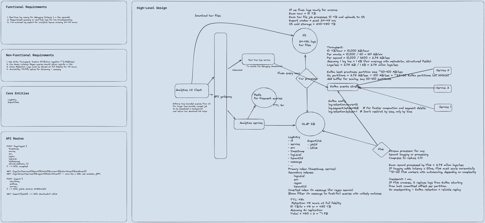

Delivery framework
1. Functional Requirements
2. Non-Functional Requirements
3. Core Entities
4. APIs
5. Data Flow
6. HLD - Counter Functional requirements
7. Deep Dives - Counter Non-Functional requirements

***

Functional Requirements:
- 
1. Real time log viewing (latency < few seconds)
2. Regex based querying on real time logs
3. Tar-archived log export for analytics team for covering 24-48 hrs

Non-Functional Requirements:
- 
1. High Write Throughput: Substain 10TB/hour ingestion (~2.8gb/sec)
2. Low Query Latency: Regex queries should return results in <2s
3. Data Retention: Logs must be stored at full fidelity for 48 hours
4. Availability: 99.99% uptime for streaming + querying

Core Entities:
-
- LogEntry
- ExportJobs

APIs
-
POST /logs/ingest { 
timestamp
source
env
region
logLevel
logMessage
structuredData[]
} --> 202 Accepted

GET /logs/tail?service={}&env={}&limit={}....
GET /logs/stream?service={}.... -> more like SSE, websocket, gRPC

POST /export {
startTime
endTime
source...
} -> 202, jobId, status: SCHEDULED

GET /export/{jobId} --> 200, downloadUrl: <jobLink>

