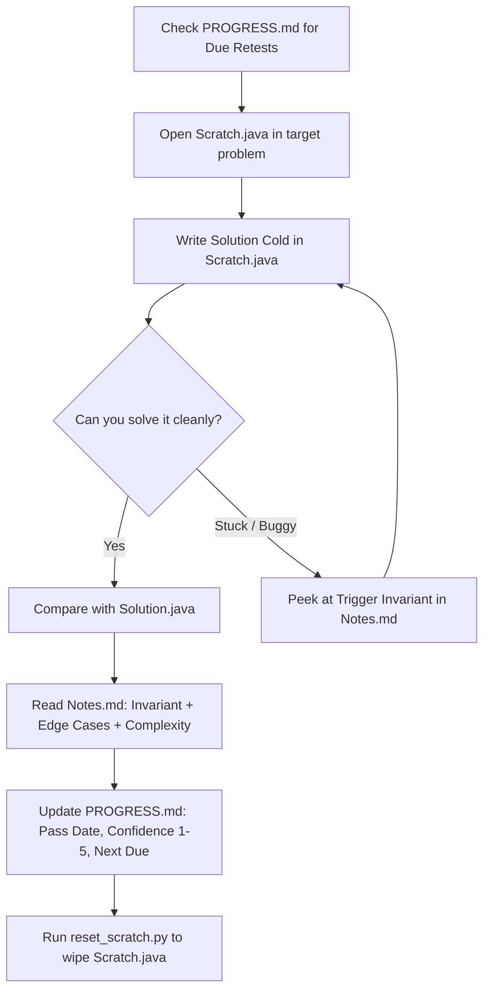

# winterArc26: Active Recall DSA Testing Engine

> **"Re-reading your old solutions creates an illusion of competence."**  
> Passive review feels fluent because recognition is easy. Active recall forces retrieval from scratch, exposing gaps before an interview does.

`winterArc26` restructures your LeetCode / NeetCode 150 repository from a passive archive into an **active testing engine**.

---

## 1. Core Principles

1. **Organized by Pattern, Not Sequence:**  
   Instead of arbitrary problem numbers or flat lists, every problem lives under its algorithmic pattern (e.g. `sliding_window/`, `monotonic_stack/`, `topological_sort/`, `two_heaps/`, `dp_knapsack/`). This trains your brain to recognize **problem archetypes** rather than memorizing problem names.

2. **The 3-File Problem Layout:**  
   Every single problem directory strictly contains:
   - **`Scratch.java` (Git-Ignored):**  
     A clean, blank skeleton containing only the exact package, imports, and method signature throwing `UnsupportedOperationException("TODO")`. When revisiting a problem, you write your solution here **cold** without looking at `Solution.java`.
   - **`Solution.java`:**  
     Production-grade, clean, optimal solution without distractions, comments, or placeholder inner classes. Fully typed and compiled against Java 21.
   - **`Notes.md`:**  
     A high-density review card containing **exactly three bullets**:
     - **Trigger Invariant:** The core condition that unlocks the pattern (e.g., monotonic condition where expanding right never invalidates earlier left constraints).
     - **Edge Cases:** Empty inputs, single elements, negatives, integer overflow boundaries (`-2^31`, `Integer.MAX_VALUE`).
     - **Complexity:** Explicit Big-O time and auxiliary space.

3. **Tracking & Spaced Repetition (`PROGRESS.md`):**  
   A master tracking table linking all 144 problems across 44 patterns with columns:
   `Problem | Category | Difficulty | Pass 1 Date | Confidence (1-5) | Retest Due`

---

## 2. Directory Structure

```text
winterArc26/
├── PROGRESS.md                    # Master tracking table & spaced repetition planner
├── README.md                      # Engine documentation & workflow guide
├── .gitignore                     # Ignores all Scratch.java files
├── common/                        # Shared LeetCode types (TreeNode, ListNode, GraphNode, etc.)
│   ├── TreeNode.java
│   ├── ListNode.java
│   ├── GraphNode.java
│   ├── RandomNode.java
│   └── Interval.java
├── tools/
│   └── reset_scratch.py           # CLI tool to regenerate blank Scratch skeletons
│
├── sliding_window/
│   ├── minimum_window_substring/
│   │   ├── Scratch.java           # [Git-ignored] Write your solution here cold
│   │   ├── Solution.java          # Optimal, clean reference implementation
│   │   └── Notes.md               # 3 bullets: Trigger Invariant, Edge Cases, Complexity
│   └── ...
├── monotonic_stack/
│   ├── daily_temperatures/
│   └── ...
├── topological_sort/
├── two_heaps/
└── ... (44 algorithmic patterns)
```

---

## 3. The Active Recall Workflow



### Step-by-Step Daily Routine:
1. **Pick Today's Target:** Check [`PROGRESS.md`](file:///Users/prakharsrivastava/IdeaProjects/MyCodeLib/winterArc26/PROGRESS.md) for problems where `Retest Due` ≤ today.
2. **Cold Solve:** Open `Scratch.java` in the target directory. Do NOT open `Solution.java` or `Notes.md`. Implement the algorithm from first principles.
3. **Validate:** Test against tricky edge cases (empty inputs, single elements, negative numbers, overflow).
4. **Debrief:** Open `Notes.md` and `Solution.java`:
   - Did your code match the trigger invariant?
   - Did you handle every identified edge case?
   - Did your time and auxiliary space match optimal Big-O?
5. **Log Score:** Record your confidence score (1 to 5) and schedule the next retest in [`PROGRESS.md`](file:///Users/prakharsrivastava/IdeaProjects/MyCodeLib/winterArc26/PROGRESS.md).
6. **Reset:** Wipe your scratch file back to a blank skeleton using `reset_scratch.py`.

---

## 4. Spaced Repetition Schedule

| Score | Meaning | Next Retest Interval |
| :---: | :--- | :---: |
| **1** | Completely blanked / could not start | **+1 day** |
| **2** | Needed hints or peeked at `Notes.md` | **+2 days** |
| **3** | Solved, but slowly (> 25 min) or with edge-case bugs | **+4 days** |
| **4** | Clean optimal solution with minor hesitation (15–20 min) | **+7 days** |
| **5** | Flawless recall, optimal code written in < 15 min | **+21 days** |

---

## 5. Scratch Management Tool (`reset_scratch.py`)

The engine provides an automated tool at [`winterArc26/tools/reset_scratch.py`](file:///Users/prakharsrivastava/IdeaProjects/MyCodeLib/winterArc26/tools/reset_scratch.py) to inspect, generate, or wipe `Scratch.java` files by parsing public signatures from `Solution.java`.

### Commands:

```bash
# 1. Create missing Scratch.java files only (safe, will not overwrite existing work)
python3 winterArc26/tools/reset_scratch.py

# 2. Reset a single problem back to a blank skeleton after retesting
python3 winterArc26/tools/reset_scratch.py sliding_window/minimum_window_substring

# 3. Reset an entire category/pattern
python3 winterArc26/tools/reset_scratch.py monotonic_stack

# 4. Wipe and regenerate all 144 Scratch.java files
python3 winterArc26/tools/reset_scratch.py --all
```

---

## 6. Algorithmic Patterns (44 Categories)

| # | Pattern Category | Problems Included |
|---|---|---|
| 1 | `hashing` | Contains Duplicate, Valid Anagram, Two Sum, Longest Consecutive Sequence, Valid Sudoku, Detect Squares |
| 2 | `bucket_sort` | Top K Frequent Elements |
| 3 | `prefix_suffix` | Product of Array Except Self |
| 4 | `serialization` | Encode and Decode Strings, Serialize and Deserialize Binary Tree |
| 5 | `two_pointers` | Valid Palindrome, Two Sum II, 3Sum, Container With Most Water, Trapping Rain Water |
| 6 | `sliding_window` | Best Time to Buy/Sell Stock, Longest Substring Without Repeating Chars, Longest Repeating Character Replacement, Permutation in String, Minimum Window Substring |
| 7 | `monotonic_deque` | Sliding Window Maximum |
| 8 | `stack` | Valid Parentheses, Min Stack, Evaluate Reverse Polish Notation |
| 9 | `monotonic_stack` | Daily Temperatures, Largest Rectangle in Histogram, Car Fleet |
| 10 | `binary_search` | Binary Search, Search 2D Matrix, Find Min in Rotated Sorted Array, Search in Rotated Sorted Array, Time Based Key-Value Store, Median of Two Sorted Arrays |
| 11 | `binary_search_on_answer` | Koko Eating Bananas |
| 12 | `in_place_reversal` | Reverse Linked List, Reorder List, Reverse Nodes in k-Group |
| 13 | `fast_slow_pointers` | Linked List Cycle, Find the Duplicate Number, Happy Number |
| 14 | `linked_list` | Merge Two Sorted Lists, Remove Nth Node From End, Add Two Numbers, Copy List with Random Pointer |
| 15 | `design` | LRU Cache |
| 16 | `k_way_merge` | Merge k Sorted Lists, Design Twitter |
| 17 | `top_k_heap` | Kth Largest Element in a Stream, Kth Largest in Array, K Closest Points, Last Stone Weight |
| 18 | `two_heaps` | Find Median from Data Stream |
| 19 | `tree_dfs` | Invert Tree, Max Depth, Diameter, Balanced Tree, Same Tree, Subtree of Another Tree, Construct from Pre/In, Max Path Sum, Good Nodes |
| 20 | `tree_bfs` | Level Order Traversal, Right Side View |
| 21 | `bst` | Lowest Common Ancestor, Validate BST, Kth Smallest Element |
| 22 | `trie` | Implement Trie, Design Add and Search Words, Word Search II |
| 23 | `backtracking` | Subsets, Combination Sum, Permutations, Generate Parentheses, Letter Combinations, Palindrome Partitioning, N-Queens, Word Search |
| 24 | `graph_dfs` | Number of Islands, Max Area of Island, Pacific Atlantic Water Flow, Surrounded Regions, Clone Graph |
| 25 | `graph_bfs` | Rotting Oranges, Walls and Gates (Islands & Treasure), Word Ladder |
| 26 | `topological_sort` | Course Schedule, Alien Dictionary |
| 27 | `union_find` | Redundant Connection, Number of Connected Components, Graph Valid Tree |
| 28 | `shortest_path` | Network Delay Time (Dijkstra), Swim in Rising Water, Cheapest Flights Within K Stops (Bellman-Ford) |
| 29 | `minimum_spanning_tree` | Min Cost to Connect All Points (Prim) |
| 30 | `eulerian_path` | Reconstruct Itinerary (Hierholzer) |
| 31 | `dp_linear` | Climbing Stairs, Min Cost Climbing Stairs, House Robber, Decode Ways, Word Break, Longest Increasing Subsequence |
| 32 | `kadane` | Maximum Subarray, Maximum Product Subarray |
| 33 | `dp_knapsack` | Partition Equal Subset Sum, Target Sum |
| 34 | `dp_unbounded_knapsack` | Coin Change, Coin Change II |
| 35 | `expand_around_center` | Longest Palindromic Substring, Palindromic Substrings |
| 36 | `dp_grid` | Unique Paths, Longest Increasing Path in a Matrix |
| 37 | `dp_two_sequences` | Longest Common Subsequence, Edit Distance, Distinct Subsequences, Interleaving String, Regular Expression Matching |
| 38 | `dp_state_machine` | Best Time to Buy and Sell Stock with Cooldown |
| 39 | `dp_interval` | Burst Balloons |
| 40 | `greedy` | Jump Game, Jump Game II, Gas Station, Hand of Straights, Merge Triplets, Partition Labels, Valid Parenthesis String, Task Scheduler |
| 41 | `intervals` | Insert Interval, Merge Intervals, Non-overlapping Intervals, Meeting Rooms, Minimum Interval to Include Each Query |
| 42 | `matrix_simulation` | Rotate Image, Spiral Matrix, Set Matrix Zeroes |
| 43 | `math` | Plus One, Pow(x, n), Multiply Strings, Reverse Integer |
| 44 | `bit_manipulation` | Single Number, Number of 1 Bits, Counting Bits, Reverse Bits, Missing Number, Sum of Two Integers |
